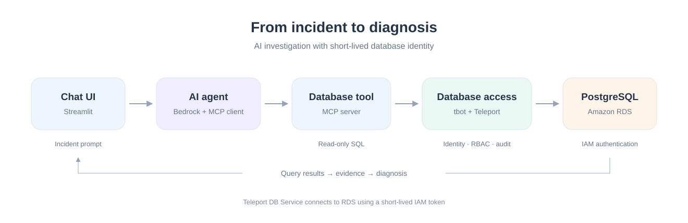

# AI SRE Agent secured by Teleport 🔐🤖

A small but complete demo: an **AI SRE agent** running on **Amazon Bedrock** that
investigates a production incident by querying a **PostgreSQL RDS** database — **without
ever holding a static database password**.

Instead of a hardcoded credential, the agent connects through **Teleport**, which gives it
a **short-lived identity** (auto-renewed every 5 minutes), enforces **least-privilege RBAC**,
and **audits every single query**.

---

## The big idea

| The "wrong way" ❌ | The Teleport way ✅ |
|---|---|
| App holds a **static DB password** | App holds **no password** — presents a short-lived cert |
| Credential never expires | Identity **auto-renews every 5 min**, expires on its own |
| Often a super-user | **Least privilege**: read-only, one database, one user |
| No record of what ran | **Every query audited** under the bot's identity |

Two security beats you'll see live:
1. **No static credential** — `db.py` sends *no* password; tbot's short-lived cert authenticates, and even the Teleport DB Service → RDS hop uses a short-lived **IAM auth token**.
2. **Least privilege + denied** — an attempt to connect as the `postgres` super-user is **refused by the Teleport proxy** before RDS is ever touched.

---

## How it works (request flow)



A deeper, fully-annotated walkthrough lives in
[`demo-ai-agent/ARCHITECTURE.md`](demo-ai-agent/ARCHITECTURE.md).

---

## What's in the box

All code is under [`demo-ai-agent/`](demo-ai-agent/):

| File | What it does |
|---|---|
| `app.py` | Streamlit chat UI + live Teleport panel (cert countdown, "Try admin → DENIED", audit link). |
| `agent_core.py` | The agent loop: Bedrock **Converse** + **MCP client**, streams events to the UI. |
| `mcp_server.py` | MCP server exposing the single tool `run_read_query` — the seam Teleport secures. |
| `db.py` | DB connection helper with the `USE_TELEPORT` toggle (static password vs. tbot tunnel). |
| `agent.py` / `agent_mcp.py` | Terminal-only versions for comparing the two approaches. |
| `admin_setup.py` | One-time: creates the least-privilege `readonly_agent` Postgres user (IAM auth). |
| `seed.sql` / `seed.py` | Create the `orders` table and plant the slow-incident data. |
| `hello_bedrock.py` | Minimal "can I call Bedrock?" smoke test. |
| `teleport/role-agent-db-readonly.yaml` | The RBAC policy: read-only, `db=opsdb`, `user=readonly_agent`. |
| `teleport/*.tmpl` | Templates for the Teleport DB Service and Machine ID (tbot) configs. |
| `teleport/setup.sh` | Mints join tokens, renders the configs, creates the role + bot. |
| `*.html` | Standalone animated architecture diagrams. |

---

## Prerequisites

- **Python 3.11+**
- An **AWS account** with:
  - **Amazon Bedrock** access to a Claude model (see the model-access note below)
  - an **RDS PostgreSQL** instance with **IAM database authentication enabled**
- A **Teleport** cluster (the demo uses a free [Teleport Cloud](https://goteleport.com/) trial) with the `tctl`, `tsh`, `teleport`, and `tbot` binaries installed
- AWS credentials configured locally (`aws configure` / environment / SSO)

> **Bedrock model access:** Anthropic models require a one-time use-case form the first
> time you enable them in an AWS account. See AWS's
> [Request access to models](https://docs.aws.amazon.com/bedrock/latest/userguide/model-access.html).

---

## Setup

```bash
cd teleport-ai-agent-demo/demo-ai-agent

python -m venv .venv
source .venv/bin/activate
pip install -r requirements.txt
```

Create a `.env` file (it is **git-ignored** — never commit real values):

```dotenv
# RDS connection (used by the "wrong way" path and for seeding)
DB_HOST=your-rds-endpoint.xxxx.ap-south-1.rds.amazonaws.com
DB_PORT=5432
DB_NAME=opsdb
DB_USER=readonly_agent
DB_PASSWORD=          # leave blank when using the Teleport path

# AWS / Bedrock
AWS_REGION=ap-south-1
BEDROCK_MODEL_ID=global.anthropic.claude-opus-4-5-...   # your enabled model id
```

Provision the database and least-privilege user, then start Teleport:

```bash
# one-time DB setup
python admin_setup.py     # create the read-only IAM user
python seed.py            # create + populate the orders table

# Teleport (DB Service + Machine ID). See teleport/setup.sh and ARCHITECTURE.md
./teleport/setup.sh
```

---

## Run the demo

```bash
./run_ui.sh          # or:  streamlit run app.py
```

Then in the UI:
- Ask something like *"checkout is slow — what's going on?"* and watch the agent reason, run read-only SQL through Teleport, and diagnose the incident.
- Use the **Teleport ↔ static password** toggle to contrast the two approaches.
- Hit **"Try admin"** to watch the super-user request get **DENIED** by Teleport.
- Watch the **certificate countdown** and the **audit** entries update live.

---
